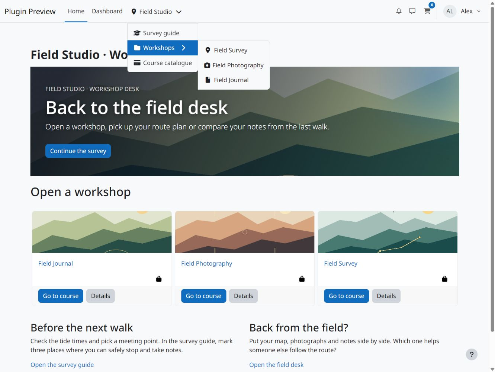
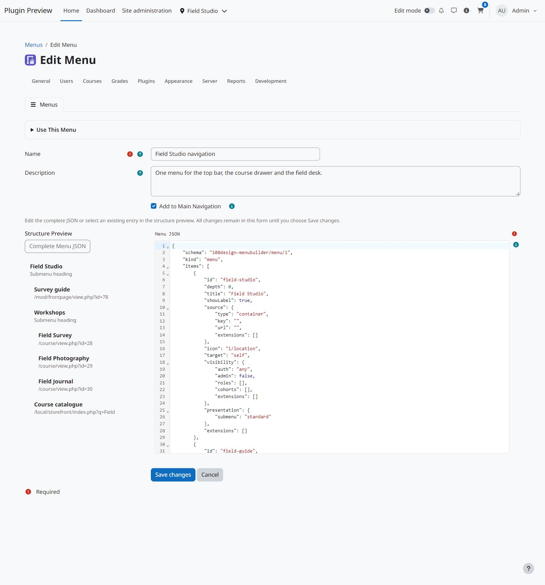
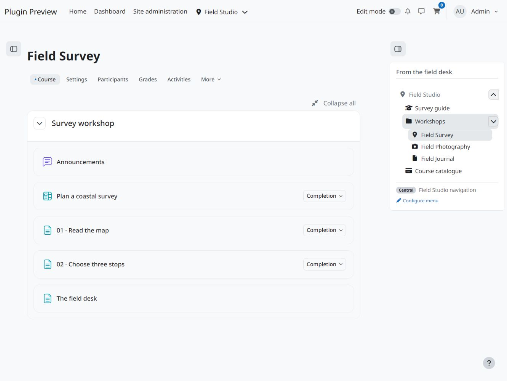
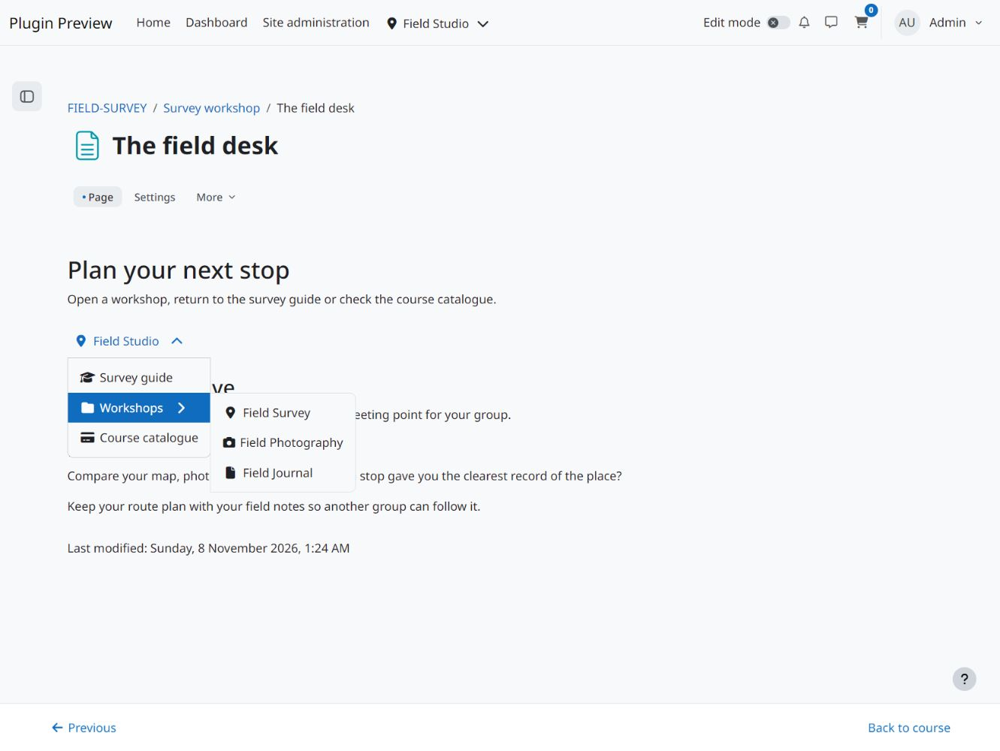

  

# Menu Builder LE

Create central navigation menus in JSON and reuse them in Moodle’s main navigation, menu blocks and filtered content. Menus support three levels, internal and external links, email links, anchors, dropdown containers, Moodle pix and Font Awesome icons, and viewer conditions.

## Screenshots

View screenshots

## Requirements and installation

Supports Moodle 4.5 through 5.3. Download the [signed beta ZIP](https://github.com/108design/moodle-local_menubuilder-le/releases) and install it as `local/menubuilder`. Administrators with `local/menubuilder:manage` can open **Site administration > Plugins > Local plugins > Menu Builder**.

## Create and use a menu

Choose **Create Menu**, enter a name and edit the JSON with syntax highlighting and error positions. The read-only structure preview lets you select an existing entry and edit its JSON separately. **Apply Entry JSON to Form** updates the complete document in the form; **Save changes** saves the menu and also applies valid pending entry changes. Add, remove and reorder entries in the complete JSON document. The help panel contains a complete example and documents each supported field. A definition supports up to 100 entries and three levels. Saving updates every use immediately. Conflicting edits require you to review the current version before saving again.

**Add to Main Navigation** assigns one menu after Moodle’s existing entries. Assigning another menu changes that global assignment. Use [Menu Builder Block](https://github.com/108design/moodle-block_frontpage_menu) for compact vertical or wide horizontal output. With [Menu Filter](https://github.com/108design/moodle-filter_frontpage_menu) enabled, paste the displayed `[[frontpage-menu:your-menu-key]]` shortcode into Moodle content. Moodle and the theme determine available block regions and filtered text areas.

The stable menu key survives renaming and editing. A duplicate receives a new key and no active main navigation assignment. Known main navigation and configured block uses prevent deletion. Check text shortcodes separately: the usage list does not search all Moodle text fields. Missing menus render empty.

Visibility conditions use login state, site administrators, system role shortnames and system cohort ID numbers. They control menu output; Moodle still checks access at the linked destination.

## Privacy

Menu records retain the identifiers of their creating and last editing administrators. Definitions can contain system role and cohort references. The Moodle privacy provider exports relevant records and anonymises administrator attribution without deleting shared menu content.

## License

This release is available free of charge under the 108design Software License.

See [LICENSE.md](LICENSE.md) for the source-available commercial terms, Moodle Marketplace permission and third-party rights. Copyright 2026 Andreas Giesen.
